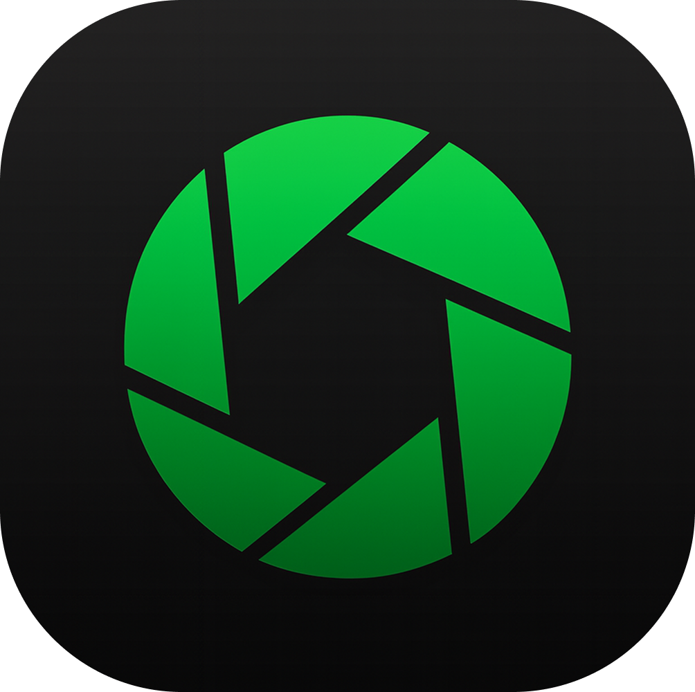

<p align="center">
  
</p>

# <p align="center">OpenScreen</p>

<p align="center"><strong>High-Performance Screen Recorder & Native Video Editor in Zig</strong></p>

<p align="center">
  <a href="LICENSE"></a>
  <a href="THIRD-PARTY-NOTICES.md"></a>
  
  
  
</p>

OpenScreen is a native, ultra-lightweight, high-performance screen recording and video editing suite engineered in Zig. It captures raw screen video, webcam, and synchronized audio, providing an instant editing environment with auto-zoom follow, motion smoothing, offline on-device speech transcription (Whisper), background matting (ONNX Runtime), and an embedded AI editing assistant and Model Context Protocol (MCP) server.

Originally built on Electron, this native Zig rewrite replaces 180MB of web runtimes and Node dependencies with a single **~15MB** native executable with instant startup, 60 fps rendering, sub-16.6ms UI frame budgets, and zero memory leaks.

---

## Key Features

- **Native Capture Orchestration:**
  - **macOS:** Apple ScreenCaptureKit (video + system audio loopback + `SCContentFilter` window exclusion).
  - **Windows:** WinRT Windows Graphics Capture (WGC) + WASAPI system audio loopback (`WDA_EXCLUDEFROMCAPTURE` window exclusion).
  - **Linux:** PipeWire (`xdg-desktop-portal` ScreenCast) + X11 XFixes fallback + PulseAudio / ALSA loopback.
- **Micro-Precision Cursor Telemetry:** Records timestamped `.cursor.jsonl` sidecars with normalized coordinates, click events, and native OS cursor shape IDs (`NSCursor`, `GetCursorInfo`, `XFixesGetCursorImage`).
- **Hardware-Accelerated Compositor:** WebGPU-native backend (`wgpu-native`) targeting Metal on macOS, D3D12/WARP on Windows, and Vulkan on Linux (with automatic CPU fallback). Verified with SSIM $\ge 0.98$ golden pixel tests.
- **On-Device Offline Intelligence:**
  - **Whisper STT (`whisper.cpp`):** Local speech-to-text with word-level timestamps and silence detection (`[silence Xs]`).
  - **Selfie Matting (`ONNX Runtime`):** Real-time webcam subject segmentation and background cutout/blur.
  - **AI Editing Assistant:** Built-in BYOK (Bring Your Own Key) LLM client supporting Anthropic Claude, OpenAI, Google Gemini, Mistral, and OpenAI-compatible endpoints.
- **Immediate-Mode Native GUI (`DVUI`):**
  - Native window management and event loops (Cocoa, Win32, X11).
  - High-DPI scaling, 8 PiP snap points, Freehand Polygon blur, and 11 timeline tracks.
  - Multi-language support across 17 locales, including full Arabic cursive RTL shaping (Presentation Forms-B) and CJK glyph rasterization.
- **Headless CLI & Model Context Protocol (MCP) Server:**
  - Full headless capability (`OPENSCREEN_TEST_HEADLESS=1`) without opening windows.
  - Strict stdout hygiene for JSON-RPC 2.0 / MCP stdio communication (`inspect_project`, `add_zoom`, `add_cut`, `export_video`, `extract_frame` as PNG).

---

## Quickstart & Building from Source

### Prerequisites
- **Zig 0.17.1**
- **FFmpeg LGPL libraries** (`libavcodec`, `libavformat`, `libavutil`, `libswscale`, `libswresample`)
- **Vulkan / Metal / DirectX 12 drivers**

### Build Commands

```bash
# Clone the repository
git clone https://github.com/getopenscreen/openscreen.git
cd openscreen

# Build native binary (optimized)
zig build -Doptimize=ReleaseFast

# Run all unit and integration tests (0 memory leaks)
zig build test

# Run UI test suite & golden pixel render tests
zig build test-ui
zig build test-golden

# Run end-to-end integration tests
zig build test-e2e

# Render visual proof screenshot artifacts
zig build render-screenshots
```

Binary will be installed into `zig-out/bin/openscreen`.

---

## Usage

### 1. Interactive Desktop GUI
```bash
./zig-out/bin/openscreen
# Or open an existing project:
./zig-out/bin/openscreen my_recording.openscreen
```

### 2. Headless CLI
```bash
# List available screen and audio sources
./zig-out/bin/openscreen sources --json

# Record 10 seconds of screen + mic headlessly
./zig-out/bin/openscreen record --duration 10 --mic --project demo.openscreen --json

# Programmatic editing (zoom and cuts)
./zig-out/bin/openscreen edit demo.openscreen --add-zoom 1.5,3.0,2.0 --json

# Transcribe audio with local Whisper model
./zig-out/bin/openscreen captions demo.openscreen --min-words 3 --max-words 7 --json

# Export project to 1080p 60fps MP4
./zig-out/bin/openscreen export demo.openscreen -o output.mp4 --resolution 1080p --fps 60 --json
```

### 3. Model Context Protocol (MCP) Server
Launch OpenScreen as an MCP stdio server for Claude Code, Cursor, or Codex:
```bash
./zig-out/bin/openscreen mcp
```
Configure in Claude Code:
```bash
claude mcp add openscreen -- /path/to/openscreen mcp
```

---

## Cross-Platform Packaging & Installation

| Platform | Format | Build / Package Command | Output |
| :--- | :--- | :--- | :--- |
| **macOS** | `.dmg` / Homebrew Cask | `./packaging/macos/build_app_dmg.sh` | `dist/OpenScreen-macOS-universal.dmg` |
| **Windows** | Portable Zip | `powershell ./packaging/windows/package_portable.ps1` | `dist/OpenScreen-v1.0.0-windows-x64-portable.zip` |
| **Windows** | Inno Setup Installer | Compile `packaging/windows/openscreen.iss` | `dist/OpenScreen-Setup-x64.exe` |
| **Linux** | Debian `.deb` | `./packaging/linux/build_deb.sh` | `dist/openscreen_1.0.0_amd64.deb` |
| **Linux** | RPM Package | `./packaging/linux/build_rpm.sh` | `dist/openscreen-1.0.0-1.x86_64.rpm` |
| **Linux** | AppImage | `./packaging/linux/build_appimage.sh` | `dist/OpenScreen-x86_64.AppImage` |
| **Linux** | Nix Flake | `nix build` or `nix run` | `result/bin/openscreen` |

---

## Legal & Compliance

OpenScreen is released under the **MIT License** (see [LICENSE](LICENSE)).

OpenScreen strictly adheres to all third-party license terms:
- **FFmpeg:** Compiled and linked as dynamic shared libraries under **GNU LGPL v2.1+**. No GPL-only flags or codecs (e.g. x264/x265) are enabled or distributed.
- **wgpu-native & whisper.cpp:** MIT / Apache-2.0.
- **ONNX Runtime:** MIT License.
- **stb_truetype:** Public Domain / MIT.
- **Bundled Fonts:** SIL Open Font License 1.1 (Inter, Lora, Oswald, Caveat, IBM Plex Mono).

For exhaustive attribution and relinking instructions, see [THIRD-PARTY-NOTICES.md](THIRD-PARTY-NOTICES.md).
